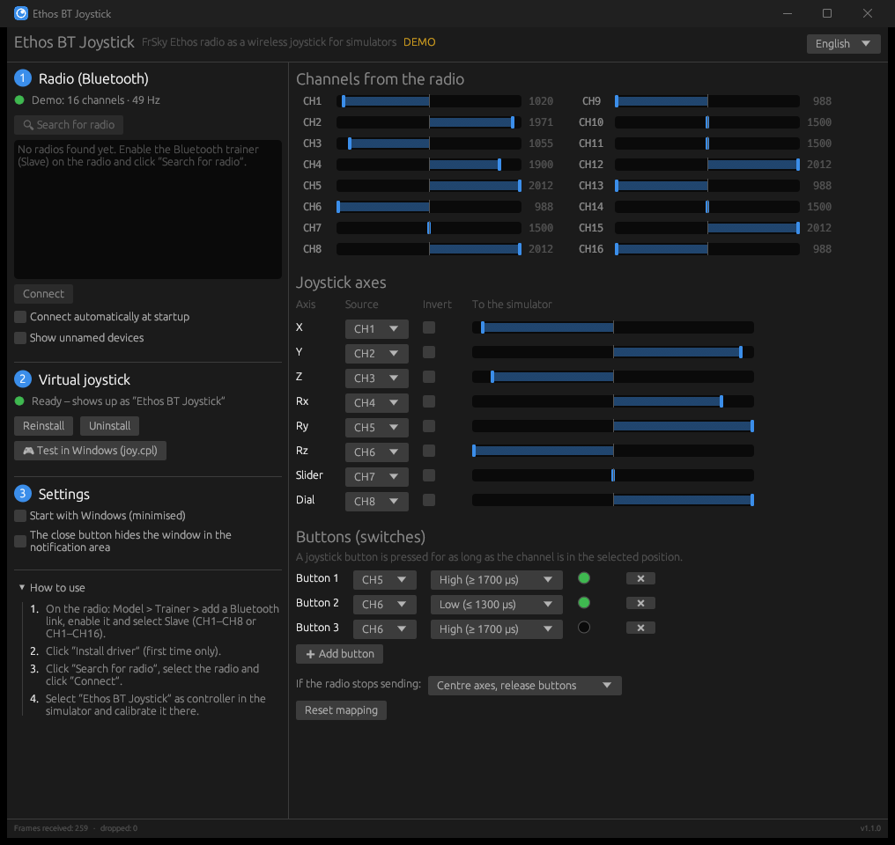
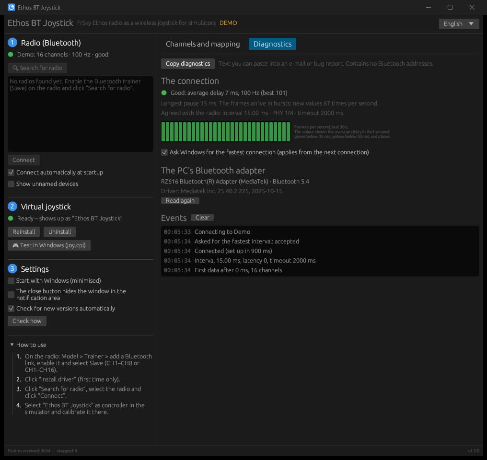

# Ethos BT Joystick

[](https://github.com/bliatun-code/EthosBtJoystick/actions/workflows/build.yml)

*English · [Norsk](README.no.md)*

Use a FrSky Ethos radio as a **wireless joystick** for simulators on Windows – over
Bluetooth, without a cable.

The radio sends its control channels through its Bluetooth trainer function. The app
receives the channels and presents them to Windows as an ordinary joystick
(“Ethos BT Joystick”) with 8 axes and up to 32 buttons.

Everything is in **a single exe file**, which you get with an installer or in a zip.
Neither vJoy nor any other third-party driver is used: the virtual joystick is a small
driver of its own that is embedded in the exe.



## Getting started

1. **On the radio:** `Model > Trainer`, add a Bluetooth link, enable it and select
   **Slave** (for example CH1–CH8 or CH1–CH16).
2. Download one of these from the
   [latest release](https://github.com/bliatun-code/EthosBtJoystick/releases/latest):
   - **The installer** (`…-setup.exe`) puts the program in the Start menu and installs
     the driver in the same step. Approve the UAC prompt.
   - **The zip** needs no installation: extract it, start `EthosBtJoystick.exe`, click
     **Install driver …** (first time only) and approve the UAC prompt.

   Windows may warn about an unknown publisher the first time, because the program is
   not code signed: click *More info* and then *Run anyway*.
3. In the program, click **Search for radio**, select the radio in the list and click
   **Connect**. Pairing in Windows is not needed.
4. Select **Ethos BT Joystick** as the controller in the simulator and calibrate it
   there.

The app remembers the radio and connects automatically the next time. If the
connection drops, it reconnects by itself.

### Running in the background

- **Start with Windows (minimised)** starts the program when you sign in, with only an
  icon in the notification area.
- **The close button hides the window in the notification area** keeps the program
  running when you close its window. Click the icon to open the window again;
  right-click it to exit.
- Starting the program a second time just brings the running one to the front.

### Diagnostics

The **Diagnostics** tab shows how good the Bluetooth link is, and helps to find out why
a connection misbehaves:



- **Link quality** – good, weak or poor, judged from the *average delay*: how old the
  newest stick positions are on average. Bluetooth delivers the frames in bursts, so
  this says more about the response than the frame rate does. The same verdict is
  shown next to the frame rate on the left.
- **Events** – every connection and disconnection, with the reason and how long the
  connection lasted.
- **The PC's Bluetooth adapter** – its name, Bluetooth version and the age of its
  driver.
- **Copy diagnostics** puts all of this on the clipboard as text, without Bluetooth
  addresses, ready to paste into an e-mail or a bug report.

The app asks Windows for the fastest connection to the radio. On the PC this was
measured on, that shortened the connection interval from 44 ms to 15 ms: all 100
frames a second arrive instead of about 90, and the longest pauses shrink from about
100 ms to about 30 ms. If a connection becomes less stable with it, switch off **Ask
Windows for the fastest connection** on the Diagnostics tab.

### Channels, axes and buttons

- **Axes:** each of the 8 axes (X, Y, Z, Rx, Ry, Rz, Slider, Dial) can take its value
  from any channel and can be inverted. 988–2012 µs from the radio gives full
  deflection.
- **Buttons:** a switch channel can be turned into joystick buttons. A button is
  pressed for as long as the channel is in the selected position: low (≤ 1300 µs),
  middle or high (≥ 1700 µs). A three-position switch therefore becomes three buttons
  on the same channel.
- **Signal loss:** after 0.5 s without data the axes are centred and the buttons
  released (can be changed to “keep the last values”).
- **If the program stops:** the driver itself returns the joystick to neutral when the
  program has been silent for a second, for example after a crash. This needs driver
  1.1; if an older driver is installed, the app offers **Update driver …**.

The **Test in Windows (joy.cpl)** button opens Windows' own game controller test.

Settings are stored in `%APPDATA%\EthosBtJoystick\config.json`.
`EthosBtJoystick.exe --demo` shows the window with simulated channels, without a radio.

## What does the driver installation do?

A virtual joystick always requires a driver on Windows. This one is a
**user-mode driver (UMDF 2)** – it runs as an ordinary process (`WUDFHost.exe`), not
in the Windows kernel.

Windows only installs signed driver packages. When you click “Install driver” in the
program, or let the installer do it, this happens (with administrator rights):

1. The driver package is unpacked to `C:\Program Files\EthosBtJoystick\driver`.
2. A self-signed certificate is created **on your PC**, the driver catalog is signed
   with it, and its public part is added as trusted (the machine's *Trusted Root* and
   *Trusted Publishers* stores).
3. **The private key is deleted immediately.** The certificate can therefore never be
   used to sign anything else – neither by you nor by anyone else.
4. The device `root\EthosBtJoystick` is created and the driver is installed on it.

**Uninstall** in the program removes the device, the driver package and the
certificate again. The log of the last installation is in
`C:\Program Files\EthosBtJoystick\install.log` and is also shown in the app.

### Uninstalling

- **Installed with the installer:** uninstall *Ethos BT Joystick* under
  *Settings > Apps > Installed apps*. That removes the program, the driver and the
  certificate.
- **Used from the zip:** click **Uninstall** in the program to remove the driver and
  the certificate, then delete the folder.

Your settings in `%APPDATA%\EthosBtJoystick` are kept in both cases.

## How it works

```
 Ethos radio                       PC
┌───────────┐  Bluetooth LE   ┌──────────────────────────────────────────────┐
│ Trainer   │  service FFF0   │ EthosBtJoystick.exe                          │
│ (Slave)   │ ──────────────► │  ble.rs       receives notifications on FFF6 │
└───────────┘  charact. FFF6  │  protocol.rs  decodes the trainer frames     │
                              │  config.rs    channel → axis/button          │
                              │  joystick.rs  writes HID report 2 ───────┐   │
                              └──────────────────────────────────────────┼───┘
                              ┌──────────────────────────────────────────▼───┐
                              │ ethosjoy.dll (UMDF 2 HID minidriver)         │
                              │  delivers the data as joystick report 1      │
                              └──────────────────────────────────────────┬───┘
                                                    Windows HID / DirectInput
                                                                         ▼
                                                                    Simulator
```

**Protocol.** The radio sends frames as `0x7E <body> 0x7E`, where the body is `0x80`,
three bytes per channel pair (two 12-bit values in µs) and an XOR checksum. `0x7D` is
the escape byte (next byte XOR `0x20`). 8 channels give 14 bytes, 16 channels 26 bytes.
This is the same format as in OpenTX/EdgeTX (`bluetooth.cpp`).

**Driver.** The driver has two HID collections: the joystick itself (what the
simulator sees) and a vendor-defined control collection that the app writes to. It
contains no logic beyond passing the values on.

## Building

Requirements: Rust (stable, `x86_64-pc-windows-msvc`) and Visual Studio 2022 Build
Tools with the C++ tools and a Windows SDK.

```powershell
# once: fetch Microsoft's WDK (about 111 MB) into tools\wdk-nuget – installs nothing
powershell -ExecutionPolicy Bypass -File tools\get-wdk.ps1

# build driver + app (add -Test to run the unit tests)
powershell -ExecutionPolicy Bypass -File build.ps1
```

The result ends up in `dist\EthosBtJoystick.exe`. To package a release as well:

```powershell
# once: fetch Inno Setup 6 (about 11 MB) into tools\innosetup – installs nothing
powershell -ExecutionPolicy Bypass -File tools\get-innosetup.ps1

# make the zip and the installer in dist\ (add -NoInstaller for the zip only)
powershell -ExecutionPolicy Bypass -File tools\package-release.ps1
```

An Inno Setup 6 that is already installed is used too.

GitHub Actions does the same for every push and pull request
([workflow](.github/workflows/build.yml)). Pushing a version tag such as `v1.2.0`
also creates a draft release with the zip and the installer attached.

| Folder | Contents |
| --- | --- |
| `app\` | The app (Rust, egui). `cargo test` runs the unit tests. |
| `driver\` | The driver (C), INF file and build script. |
| `installer\` | The Inno Setup script for the installer. |
| `tools\` | Scripts that fetch the WDK and Inno Setup, draw the icon and package a release. |
| `app\examples\` | Developer tools: `scan` (Bluetooth search), `hidtree` (HID lookup), `joycheck` (writes to the installed driver and reads back) and `adapterinfo` (prints the diagnostics report). |

## Troubleshooting

- **The radio does not show up in the list:** check that the Bluetooth trainer is set
  to *Slave* and enabled, and that Bluetooth is on in Windows. Radios are marked
  “FrSky” in the list. If needed, tick “Show unnamed devices”.
- **“Connected, waiting for data”:** the radio is connected but is not sending trainer
  frames. Check the trainer setup of the model.
- **Control feels laggy or jerky:** look at the Diagnostics tab. A frame rate well
  below the best rate together with an average delay above about 35 ms means a weak
  Bluetooth signal. Move the radio closer, and on a desktop PC check that the antennas
  of the Wi-Fi/Bluetooth card are fitted – without them the range is very short.
- **The connection drops after a few seconds, again and again:** that points to the
  PC's Bluetooth adapter or its driver. Try a newer driver (the Microsoft Update
  Catalog may have one when Windows Update offers none) or another adapter.
- **The driver “did not start (code …)”:** open the installation log in the app. Try
  “Reinstall”. The code is the same one Device Manager shows.
- **The simulator does not find the joystick:** check with “Test in Windows (joy.cpl)”
  first. Some simulators have to be restarted after the driver has been installed.

Still stuck? [Open an issue](https://github.com/bliatun-code/EthosBtJoystick/issues/new/choose)
and paste the text from **Copy diagnostics** on the Diagnostics tab.

## Limitations

- The driver requires **Windows 11** (64-bit). The project has only been built and
  tried on Windows 11.
- Smart App Control or company policies that block unsigned programs can stop the
  installer, the app and the driver.

## Thanks to

- [FrSky-Bluetooth-Trainer](https://github.com/garfield2412/FrSky-Bluetooth-Trainer)
  for inspiration and for confirming the frame format used by Ethos.
- OpenTX/EdgeTX for the original Bluetooth trainer protocol.
- Microsoft's driver sample `vhidmini2`, from which the request handling in the driver
  is derived.

## License

- The project is licensed under the **MIT License**, see [LICENSE](LICENSE).
- Exception: the contents of the `driver/` folder are derived from Microsoft's
  `vhidmini2` sample and are licensed under the **Microsoft Public License (MS-PL)**,
  see [driver/LICENSE](driver/LICENSE).

This is an independent hobby project and is not affiliated with FrSky. FrSky and ETHOS
are trademarks of their respective owners.
