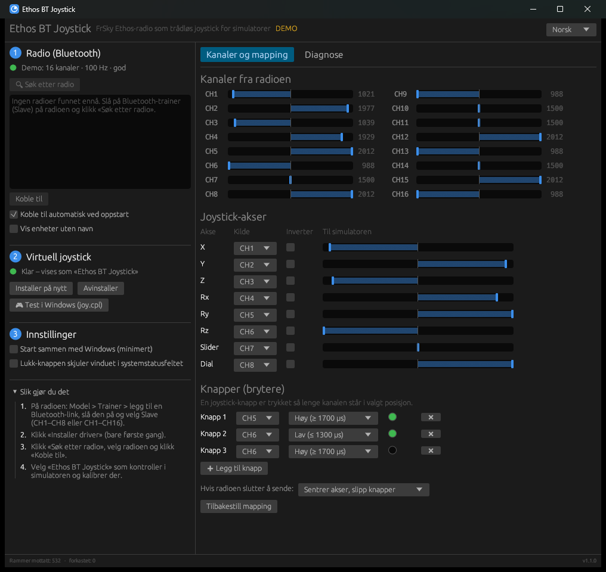
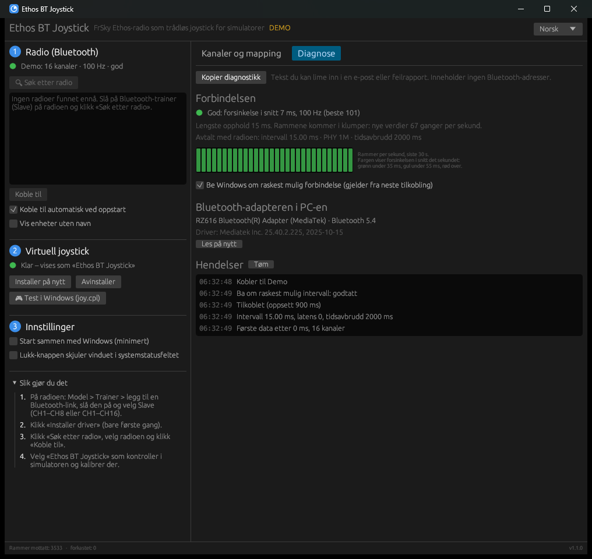

# Ethos BT Joystick

[](https://github.com/bliatun-code/EthosBtJoystick/actions/workflows/build.yml)

*Norsk · [English](README.md)*

Bruk en FrSky Ethos-radio som **trådløs joystick** for simulatorer på Windows – over
Bluetooth, uten kabel.

Radioen sender styrekanalene sine via Bluetooth-trainer-funksjonen. Appen tar imot
kanalene og presenterer dem for Windows som en vanlig joystick («Ethos BT Joystick»)
med 8 akser og opptil 32 knapper.

Alt ligger i **én exe-fil**. Det brukes verken vJoy eller andre tredjepartsdrivere:
den virtuelle joysticken er en egen liten driver som følger med i exe-filen og
installeres med ett klikk.



## Kom i gang

1. **På radioen:** `Model > Trainer`, legg til en Bluetooth-link, slå den på og velg
   **Slave** (for eksempel CH1–CH8 eller CH1–CH16).
2. Last ned zip-filen fra
   [siste release](https://github.com/bliatun-code/EthosBtJoystick/releases/latest),
   pakk den ut og start `EthosBtJoystick.exe`. Windows kan advare om ukjent utgiver
   første gang, fordi programmet ikke er kodesignert.
3. Klikk **Installer driver …** (bare første gang) og godkjenn UAC-spørsmålet.
4. Klikk **Søk etter radio**, velg radioen i listen og klikk **Koble til**.
   Windows-paring er ikke nødvendig.
5. Velg **Ethos BT Joystick** som kontroller i simulatoren og kalibrer der.

Appen husker radioen og kobler til automatisk neste gang. Faller forbindelsen ut,
kobles det til igjen av seg selv.

### Kjøre i bakgrunnen

- **Start sammen med Windows (minimert)** starter programmet når du logger på, med
  bare et ikon i systemstatusfeltet.
- **Lukk-knappen skjuler vinduet i systemstatusfeltet** lar programmet kjøre videre
  når du lukker vinduet. Klikk på ikonet for å åpne vinduet igjen; høyreklikk for å
  avslutte.
- Starter du programmet en gang til, kommer bare det som allerede kjører fram.

### Diagnose

Fanen **Diagnose** viser hvor god Bluetooth-forbindelsen er, og hjelper deg å finne ut
hvorfor en forbindelse oppfører seg dårlig:



- **Kvalitet** – god, svak eller dårlig, vurdert ut fra *forsinkelsen i snitt*: hvor
  gamle de nyeste spakverdiene er i gjennomsnitt. Bluetooth leverer rammene i klumper,
  så dette sier mer om responsen enn oppdateringsfrekvensen gjør. Samme vurdering
  står ved siden av frekvensen til venstre.
- **Hendelser** – hver til- og frakobling, med årsak og hvor lenge forbindelsen varte.
- **Bluetooth-adapteren i PC-en** – navn, Bluetooth-versjon og alderen på driveren.
- **Kopier diagnostikk** legger alt dette på utklippstavlen som tekst, uten
  Bluetooth-adresser, klart til å limes inn i en e-post eller feilrapport.

Appen ber Windows om raskest mulig forbindelse til radioen. På PC-en dette ble målt
på, kortet det ned forbindelsesintervallet fra 44 ms til 15 ms: alle 100 rammene i
sekundet kommer fram i stedet for rundt 90, og de lengste oppholdene krymper fra
rundt 100 ms til rundt 30 ms. Blir en forbindelse mindre stabil av det, slår du av
**Be Windows om raskest mulig forbindelse** i fanen Diagnose.

### Kanaler, akser og knapper

- **Akser:** hver av de 8 aksene (X, Y, Z, Rx, Ry, Rz, Slider, Dial) kan hente verdien
  fra en valgfri kanal, og kan inverteres. 988–2012 µs fra radioen blir fullt utslag.
- **Knapper:** en bryterkanal kan gjøres om til joystick-knapper. En knapp er trykket
  så lenge kanalen står i valgt posisjon: lav (≤ 1300 µs), midt eller høy (≥ 1700 µs).
  En treveisbryter blir altså tre knapper på samme kanal.
- **Tap av signal:** etter 0,5 s uten data sentreres aksene og knappene slippes
  (kan endres til «behold siste verdier»).
- **Hvis programmet stopper:** driveren setter selv joysticken i nøytral når
  programmet har vært stille i ett sekund, for eksempel etter en krasj. Dette krever
  driver 1.1; er en eldre driver installert, tilbyr appen **Oppdater driver …**.

Knappen **Test i Windows (joy.cpl)** åpner Windows' egen spillkontroller-test.

Innstillingene lagres i `%APPDATA%\EthosBtJoystick\config.json`.
`EthosBtJoystick.exe --demo` viser vinduet med simulerte kanaler, uten radio.

## Hva gjør driverinstallasjonen?

En virtuell joystick krever alltid en driver på Windows. Denne er en
**brukermodus-driver (UMDF 2)** – den kjører som en vanlig prosess (`WUDFHost.exe`)
og ikke i Windows-kjernen.

Windows installerer bare signerte driverpakker. Når du klikker «Installer driver»
skjer derfor dette (med administratorrettigheter):

1. Driverpakken pakkes ut til `C:\Program Files\EthosBtJoystick\driver`.
2. Det lages et selvsignert sertifikat **på din PC**, driverkatalogen signeres med
   det, og den offentlige delen legges inn som klarert (lagrene *Trusted Root* og
   *Trusted Publishers* for maskinen).
3. **Den private nøkkelen slettes med en gang.** Sertifikatet kan dermed aldri brukes
   til å signere noe annet – verken av deg eller andre.
4. Enheten `root\EthosBtJoystick` opprettes og driveren installeres på den.

**Avinstaller** fjerner enheten, driverpakken og sertifikatet igjen.
Loggen fra siste installasjon ligger i `C:\Program Files\EthosBtJoystick\install.log`
og vises også i appen.

## Slik virker det

```
 Ethos-radio                       PC
┌───────────┐  Bluetooth LE   ┌──────────────────────────────────────────────┐
│ Trainer   │  tjeneste FFF0  │ EthosBtJoystick.exe                          │
│ (Slave)   │ ──────────────► │  ble.rs       tar imot varsler på FFF6       │
└───────────┘  karakt. FFF6   │  protocol.rs  dekoder trainer-rammene        │
                              │  config.rs    kanal → akse/knapp             │
                              │  joystick.rs  skriver HID-rapport 2 ─────┐   │
                              └──────────────────────────────────────────┼───┘
                              ┌──────────────────────────────────────────▼───┐
                              │ ethosjoy.dll (UMDF 2 HID-minidriver)         │
                              │  leverer dataene som joystick-rapport 1      │
                              └──────────────────────────────────────────┬───┘
                                                    Windows HID / DirectInput
                                                                         ▼
                                                                    Simulator
```

**Protokoll.** Radioen sender rammer som `0x7E <innhold> 0x7E`, der innholdet er
`0x80`, tre byte per kanalpar (to 12-bits verdier i µs) og en XOR-sjekksum. `0x7D`
er escape-tegn (neste byte XOR `0x20`). 8 kanaler gir 14 byte, 16 kanaler 26 byte.
Dette er samme format som i OpenTX/EdgeTX (`bluetooth.cpp`).

**Driver.** Driveren har to HID-samlinger: selve joysticken (det simulatoren ser) og
en leverandørdefinert kontrollsamling som appen skriver til. Den inneholder ingen
logikk utover å videreformidle verdiene.

## Bygge selv

Krav: Rust (stable, `x86_64-pc-windows-msvc`) og Visual Studio 2022 Build Tools med
C++-verktøy og Windows SDK.

```powershell
# én gang: hent Microsofts WDK (ca. 111 MB) til tools\wdk-nuget – installerer ingenting
powershell -ExecutionPolicy Bypass -File tools\get-wdk.ps1

# bygg driver + app (legg til -Test for å kjøre enhetstestene)
powershell -ExecutionPolicy Bypass -File build.ps1
```

Resultatet havner i `dist\EthosBtJoystick.exe`. `tools\package-release.ps1` pakker
den deretter i en release-zip sammen med lisensfilene.

GitHub Actions gjør det samme for hver push og pull request
([arbeidsflyt](.github/workflows/build.yml)). En versjons-tag som `v1.2.0` lager i
tillegg et utkast til release med zip-filen vedlagt.

| Mappe | Innhold |
| --- | --- |
| `app\` | Appen (Rust, egui). `cargo test` kjører enhetstestene. |
| `driver\` | Driveren (C), INF-fil og byggeskript. |
| `tools\` | Skript for å hente WDK og pakke en release. |
| `app\examples\` | Utviklerverktøy: `scan` (Bluetooth-søk), `hidtree` (HID-oppslag), `joycheck` (skriver til den installerte driveren og leser tilbake) og `adapterinfo` (skriver ut diagnoserapporten). |

## Feilsøking

- **Radioen dukker ikke opp i listen:** sjekk at Bluetooth-trainer står på *Slave* og
  er slått på, og at Bluetooth er på i Windows. Radioer merkes med «FrSky» i listen.
  Kryss eventuelt av for «Vis enheter uten navn».
- **«Tilkoblet, venter på data»:** radioen er tilkoblet, men sender ikke
  trainer-rammer. Sjekk trainer-oppsettet på modellen.
- **Styringen føles treg eller rykkete:** se på fanen Diagnose. En frekvens godt under
  den beste sammen med en forsinkelse i snitt over omtrent 35 ms betyr svakt
  Bluetooth-signal. Flytt radioen nærmere, og sjekk på en stasjonær PC at antennene
  til WiFi/Bluetooth-kortet er montert – uten dem er rekkevidden svært kort.
- **Forbindelsen faller etter noen sekunder, gang på gang:** det tyder på
  Bluetooth-adapteren i PC-en eller driveren dens. Prøv en nyere driver (Microsoft
  Update-katalogen kan ha en selv om Windows Update ikke tilbyr noen) eller en annen
  adapter.
- **Driveren «startet ikke (kode …)»:** åpne installasjonsloggen i appen. Prøv
  «Installer på nytt». Koden er den samme som Enhetsbehandling viser.
- **Simulatoren finner ikke joysticken:** sjekk først med «Test i Windows (joy.cpl)».
  Noen simulatorer må startes på nytt etter at driveren er installert.

Står du fortsatt fast? [Opprett en sak (issue)](https://github.com/bliatun-code/EthosBtJoystick/issues/new/choose)
og lim inn teksten fra **Kopier diagnostikk** i fanen Diagnose. Skjemaet er på engelsk,
men du kan gjerne skrive på norsk.

## Begrensninger

- Driveren krever **Windows 11** (64-bit). Prosjektet er bare bygget og prøvd på Windows 11.
- Smart App Control eller bedriftspolicyer som blokkerer usignerte programmer kan
  stoppe både appen og driveren.

## Takk til

- [FrSky-Bluetooth-Trainer](https://github.com/garfield2412/FrSky-Bluetooth-Trainer)
  for inspirasjon og bekreftelse på rammeformatet fra Ethos.
- OpenTX/EdgeTX for den opprinnelige Bluetooth-trainer-protokollen.
- Microsofts driver-eksempel `vhidmini2`, som forespørselshåndteringen i driveren er
  avledet av.

## Lisens

- Prosjektet er lisensiert under **MIT-lisensen**, se [LICENSE](LICENSE).
- Unntak: innholdet i mappen `driver/` er avledet av Microsofts eksempel `vhidmini2`
  og er lisensiert under **Microsoft Public License (MS-PL)**, se
  [driver/LICENSE](driver/LICENSE).

Dette er et uavhengig hobbyprosjekt og har ingen tilknytning til FrSky. FrSky og
ETHOS er varemerker som tilhører sine respektive eiere.
